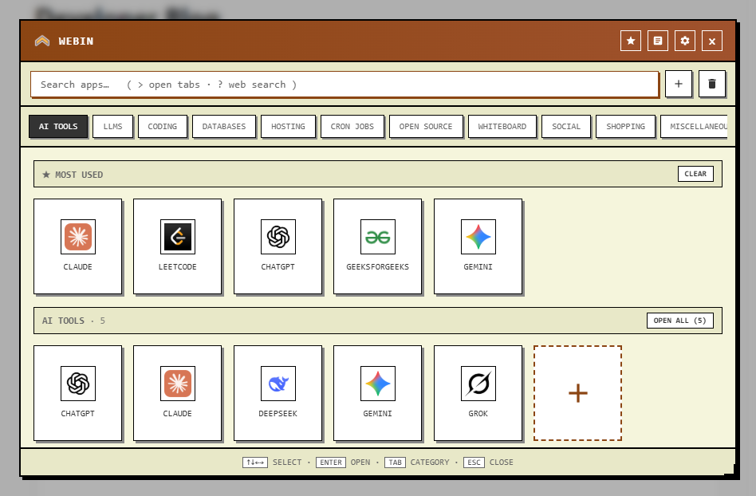
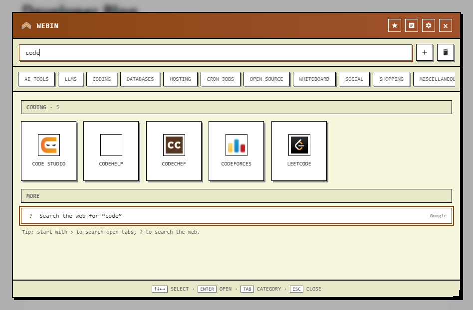
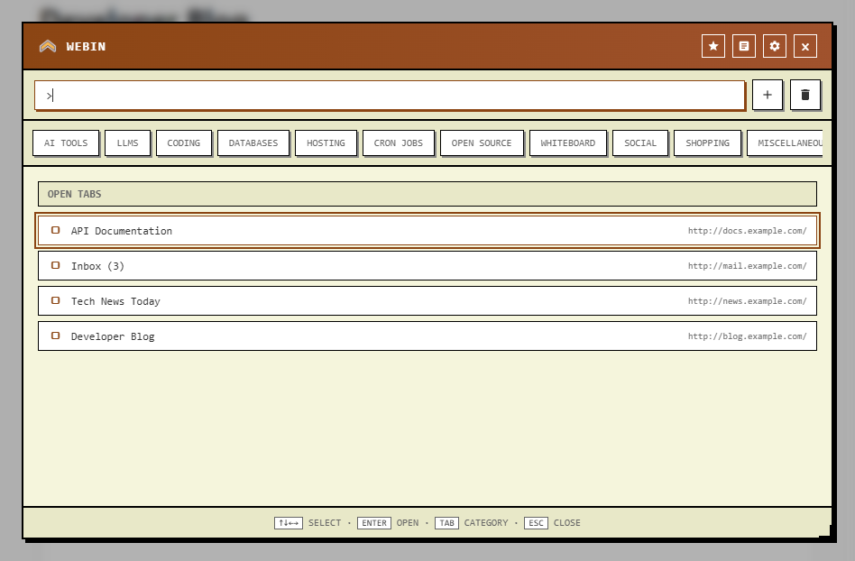
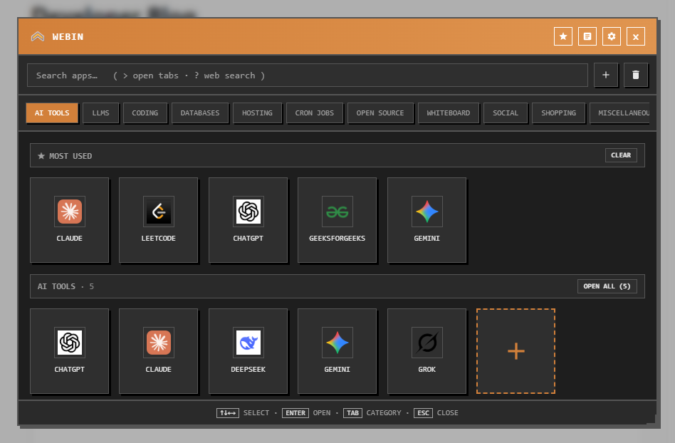
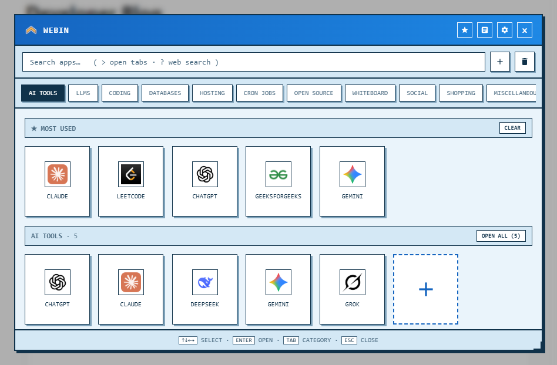
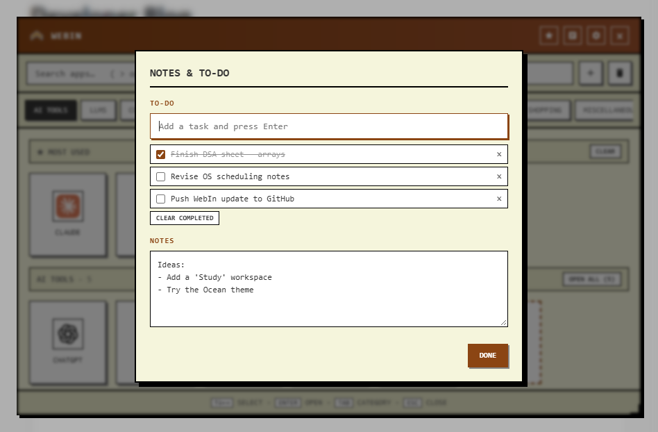
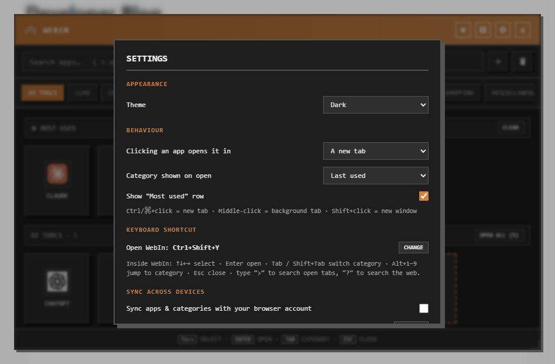

# WebIn - Quick Access Browser Extension


**WebIn** is a sleek, retro-styled browser extension that gives you instant access to your favorite websites through a customizable overlay dashboard. No more cluttered bookmarks or endless tab searching.

> **Credits:** Based on [WebIn](https://github.com/avdeshjadon/WebIn) by **Avdesh Jadon** (original author).
> Extended by **[Rajat Sankhyan](https://github.com/rajatsankhyan)** with Brave support, keyboard navigation, command palette, themes, sync, backup/import, notes and more (v2.1).

<p align="center">
  
</p>

## ✨ Features

| Feature | Description |
|---------|-------------|
| ⌨️ **Quick Launch** | `Cmd+Shift+Y` (Mac) / `Ctrl+Shift+Y` (Windows/Linux), or click the toolbar icon |
| 🎹 **Keyboard Navigation** | Arrows to select, `Enter` to open, `Tab` / `Alt+1-9` to switch category, `Esc` to close |
| ⭐ **Add Current Page** | One click saves the page you're on (name + URL filled in) |
| 🔍 **Command Palette** | Search apps in all categories by name or URL · `>` switch to an open tab · `?` web search |
| 🖱️ **Smart Opening** | New tab or same tab (setting) · `Ctrl`+click new tab · middle-click background · `Shift`+click new window |
| ↕️ **Drag to Reorder** | Drag apps and categories; double-click a category to rename it |
| 🗂️ **Workspaces** | "Open all" opens a whole category as a named tab group |
| ★ **Most Used** | Your most-opened apps appear at the top |
| 🎨 **Themes** | Auto (system), Retro, Dark, Ocean, Forest |
| 📝 **Notes & To-do** | Quick notes and a to-do list inside the overlay |
| 💾 **Backup / Import** | Export & import JSON, import folders from bookmarks |
| 🔄 **Cross-Device Sync** | Optional sync through your browser account (Chrome / Brave Sync) |
| ⚙️ **Options Page** | All settings, also available from the browser's extension menu |
| 🦁 **Brave & Chromium** | Works in Chrome, Brave, Edge; falls back to a popup window on internal pages |
| 🛡️ **Zero Conflicts** | Shadow DOM isolation prevents style clashes |

## 📸 Screenshots

| Search across all categories | Switch to an open tab (`>`) |
|---|---|
|  |  |
| **Dark theme** | **Ocean theme** |
|  |  |
| **Notes & To-do** | **Settings** |
|  |  |

## 🎯 Why WebIn?

- **Fast**: One keyboard shortcut to access everything
- **Customizable**: Add, edit, delete apps and categories
- **Lightweight**: Minimal footprint, no performance impact
- **Privacy First**: Your data stays in your browser
- **Beautiful UI**: Retro-styled design that stands out

## 🚀 Installation

1. **Clone** the repository
   ```bash
   git clone https://github.com/avdeshjadon/WebIn.git
   ```

2. Open **`chrome://extensions/`** in Chrome (or **`brave://extensions/`** in Brave)

3. Enable **Developer Mode** (top-right toggle)

4. Click **Load unpacked** → Select the `WebIn` folder

5. Press `Cmd+Shift+Y` / `Ctrl+Shift+Y` to launch!

## 📖 Usage

| Action | How To |
|--------|--------|
| **Open WebIn** | `Cmd+Shift+Y` / `Ctrl+Shift+Y` |
| **Add Category** | Click `+` button in search bar |
| **Add App** | Click `+` card in any category |
| **Edit App** | Hover on card → Click menu (⋮) |
| **Delete App** | Hover → Menu → Delete |
| **Delete Category** | Click trash icon on category |
| **Search** | Type to filter across all apps |
| **Resize** | Drag bottom-right corner |
| **Move** | Drag the header bar |

## 🛠️ Tech Stack

- **JavaScript** (ES6+ Modules)
- **Chrome Extension** Manifest V3
- **Shadow DOM** for style isolation
- **Chrome Storage API** for persistence
- **chrome.storage.sync** (optional cross-device sync)

## 📂 Project Structure

```
WebIn/
├── webin/                 # Core extension module
│   ├── inject.js          # Main entry point
│   ├── config.js          # Default configuration
│   ├── state.js           # State management
│   ├── ui.js              # UI rendering
│   ├── modals.js          # Modal dialogs
│   ├── events.js          # Event handlers
│   ├── tabs.js            # Tab/category management
│   ├── app.js             # Shared UI builder (overlay + popup)
│   ├── settings.js        # Settings, notes, backup/import
│   ├── util.js            # Escaping, URL checks, messaging
│   └── styles[1-4].js     # CSS-in-JS styles
├── images/                # Extension icons
├── options.html           # Settings page
├── popup.html             # Fallback window for internal pages
├── background.js          # Service worker
├── manifest.json          # Extension manifest
└── LICENSE                # Proprietary license
```

## ⚠️ License

**PROPRIETARY SOFTWARE** - All Rights Reserved.

This software is the exclusive property of [Avdesh Jadon](https://github.com/avdeshjadon). No permission is granted to use, copy, modify, or distribute without explicit written consent.

See [LICENSE](LICENSE) for full details.

## 👨‍💻 Authors

<table>
  <tr>
    <td align="center">
      <strong>Avdesh Jadon</strong><br>
      <a href="https://github.com/avdeshjadon">GitHub</a> •
      <a href="https://linkedin.com/in/avdeshjadon">LinkedIn</a> •
      <a href="mailto:theavdeshjadon@gmail.com">Email</a><br>
      <sub>Original author</sub>
    </td>
    <td align="center">
      <strong>Rajat Sankhyan</strong><br>
      <a href="https://github.com/rajatsankhyan">GitHub</a><br>
      <sub>v2.1 extensions</sub>
    </td>
  </tr>
</table>

---

<p align="center">
  <strong>© 2024-2026 Avdesh Jadon. All Rights Reserved.</strong>
</p>
